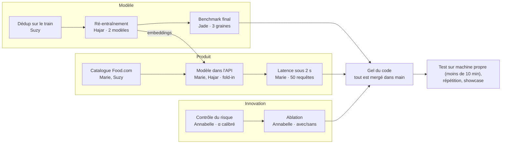

# StudEat – Feuille de route jusqu'au showcase

*Mise à jour : 25/11/2026 – Jade PARRILLA (PL)*

## Où en est le projet

La partie « process » (10 points) est bouclée ; tout se joue maintenant sur le produit (10 points + bonus) : une **démo qui marche** avec le vrai modèle, et un **dépôt qui se lance en moins de 10 minutes**. Aujourd'hui, l'application tourne mais recommande au hasard, et l'innovation (le contrôle du risque) n'existe pas encore dans le code.

| Exigence des consignes | Points | État au 25/11 |
| --- | --- | --- |
| Plan, rapports semaines 2 et 3 | 10 | Rendus |
| Présentation et démo *qui fonctionne* | 5 | API et interface OK, mais `predict()` renvoie encore des scores aléatoires |
| Code et documentation (GitHub) | 5 | Pipeline, modèle, entraînement, logs : OK. README à jour mais il promet `models/embeddings.npz`, absent du dépôt |
| Innovation prouvée (métrique dédiée + ablation) | jugée dans la démo et le code | Contrôle du risque conçu, pas implémenté |
| Bonus top 4 (50 % votes VC + 50 % note technique) | +3 | Dépend d'une démo convaincante et personnalisée |

Côté résultats, NLGCL et LightGCN sont au niveau de la popularité (NDCG@10 ≈ 0,024) : c'est un fait à assumer et à expliquer, pas à cacher. Deux branches attendent encore : `pl/evaluation` (pas de PR) et `se/foodcom-catalogue` (pas de PR).

## Les 5 bloquants à régler en premier

Chacun de ces points coûte directement des points le jour J ; ils passent avant tout le reste.

1. **La démo recommande au hasard.** Le `Recommender` existe (PR #9) mais l'API ne l'appelle pas : `predict()` mélange les repas et répond `"model": "mock (random scores)"`. Le professeur vérifiera la cohérence du système.
2. **Tous les étudiants de la démo seront nouveaux, donc le modèle ne servira jamais.** Un étudiant créé dans l'app n'a pas d'embedding : le `Recommender` retombe sur la popularité. Sans correctif, chaque visiteur verra la même box. Correctif simple (« fold-in ») : le vecteur d'un nouvel étudiant = la moyenne des vecteurs des repas qu'il a notés 4 ou 5 dans `app_ratings`. Il faut pour ça que les repas de l'app aient les identifiants Food.com, donc le catalogue de Marie.
3. **Le README promet un fichier qui n'existe pas.** Il annonce `models/embeddings.npz` « fourni », mais le `.gitignore` exclut encore tout `models/` et le fichier n'est pas dans le dépôt. La règle des 10 minutes est « non négociable ».
4. **L'innovation n'est pas dans le code.** Le contrôle du risque (calibration conforme sur la validation, taux de repas non désirés) est seulement décrit. C'est pourtant ce qui distingue StudEat d'un simple LightGCN, et donc l'argument central du pitch.
5. **Les chiffres finaux ne sont pas encore calculés.** Le split a changé (PR #10) : il faut ré-entraîner, puis produire un seul tableau final (Random, Most-Popular, LightGCN, NLGCL, NLGCL + contrôle du risque) sur 3 graines, avec le même harness.

## Tâches restantes

20 tâches, dont 11 bloquantes (P0). La colonne « Dépend de » renvoie au numéro de la tâche qui doit être finie avant. Cochez la case quand la tâche est faite.

| # | Tâche | Responsable | Priorité | Dépend de | Fait |
| --- | --- | --- | --- | --- | --- |
| 1 | Ouvrir et merger la PR `pl/evaluation` (renommer en `run_baselines.py`) | Jade | P0 | – | ☐ |
| 2 | Déduplication calculée sur le train seulement (dernière fuite) | Suzy | P1 | – | ☐ |
| 3 | Ré-entraîner NLGCL et LightGCN sur le split final, choisir sur la validation | Hajar | P0 | 2 | ☐ |
| 4 | Exporter `models/embeddings.npz`, l'autoriser dans `.gitignore`, le commiter | Hajar, Jade | P0 | 3 | ☐ |
| 5 | Merger le catalogue Food.com (`se/foodcom-catalogue`), plats principaux, 250 kcal min. | Marie, Suzy | P0 | – | ☐ |
| 6 | Brancher le `Recommender` dans `predict()` de l'API | Marie | P0 | 4, 5 | ☐ |
| 7 | Fold-in des nouveaux étudiants (moyenne des repas notés 4 ou 5) | Hajar | P0 | 5 | ☐ |
| 8 | Contrôle du risque : calibration sur la validation + taux de repas non désirés | Annabelle | P0 | 3 | ☐ |
| 9 | Ablation avec / sans contrôle du risque | Annabelle | P0 | 8 | ☐ |
| 10 | Benchmark final, 3 graines, un seul tableau (moyenne ± écart-type) | Jade | P0 | 3, 9 | ☐ |
| 11 | Mesurer la latence de `/recommend` sur 50 requêtes (< 2 s) | Marie | P1 | 6 | ☐ |
| 12 | Adapter `seed_test_data.py` aux identifiants Food.com | Suzy | P1 | 5 | ☐ |
| 13 | 3 exemples d'étudiants pour le pitch (historique vs box reçue) | Hajar | P1 | 6, 7 | ☐ |
| 14 | Regrouper les 3 baselines de popularité en une seule | Jade | P2 | 1 | ☐ |
| 15 | Ajouter une option `--reg` à `train.py` | Annabelle | P2 | – | ☐ |
| 16 | Harmoniser les commentaires du code en anglais | Tous | P2 | – | ☐ |
| 17 | Test sur machine propre, chronométré, par quelqu'un qui n'a pas écrit le code | Jade | P0 | 1 à 12 | ☐ |
| 18 | Pitch et slides (innovation, résultats honnêtes, démo) | Jade | P0 | 10 | ☐ |
| 19 | Poster ou flyer d'une page | Marie | P1 | 10 | ☐ |
| 20 | Campagne de notation réelle, si le temps le permet | Suzy | P2 | 6, 7 | ☐ |

*P0 = bloquant, P1 = important, P2 = si le temps le permet.*

## Ordre des chantiers

Les trois chantiers avancent en parallèle et se rejoignent au gel du code : rien ne part au test final tant que tout n'est pas mergé dans `main`.

Le contrôle du risque peut être développé dès maintenant sur le modèle actuel, puis recalibré après le ré-entraînement. Ordre de merge : `pl/evaluation` et le catalogue Food.com d'abord, puis l'API branchée sur les embeddings, puis le contrôle du risque.

**Question ouverte :** la date du showcase et notre session (matin groupes 1-10 / après-midi groupes 11-20) ne figurent pas dans les consignes. Une fois connues, fixer le gel du code au moins deux jours avant, pour laisser le temps au test sur machine propre et à la répétition.

## Le jour du showcase

Le professeur visite chaque stand pour poser des questions techniques et **lire le code** ; les autres groupes votent avec leur budget de VC. Le classement final = 50 % d'investissements reçus + 50 % de note technique.

**Pitch (2 à 3 minutes)**

- [ ] Le problème : un étudiant veut des repas qui respectent son budget, son régime et ses allergies
- [ ] L'innovation en une phrase : NLGCL + contrôle du risque qui limite les repas non désirés sous un seuil α garanti
- [ ] Les résultats honnêtes : le tableau final, y compris « au niveau de la popularité », et ce que le contrôle du risque apporte
- [ ] Ce qui vient ensuite si on était financés (vraies notes d'étudiants, prix réels)

**Démo en direct (scénario répété)**

- [ ] Créer un profil (ex. végétarien, sans gluten, 40 €) → box qui respecte les contraintes
- [ ] Noter 3 ou 4 repas → redemander une box : elle change (fold-in), c'est le moment fort
- [ ] Montrer le code : `model_nlgcl.py`, `evaluation.py`, le contrôle du risque
- [ ] Plan B sans réseau : tout tourne en local, plus des captures et une courte vidéo de la démo

**Questions techniques à préparer (chacun doit savoir y répondre)**

- [ ] Comment évitez-vous les fuites de données ? (split temporel, k-core et graphe sur le train seul, test utilisé une fois)
- [ ] Pourquoi le modèle ne bat-il pas la popularité ? (≈ 13 notes par utilisateur, split temporel, 40 % du test sur des inconnus)
- [ ] Que fait la loss contrastive de NLGCL, et pourquoi λ = 0,001 ?
- [ ] Comment gérez-vous un nouvel étudiant ? (fold-in, sinon popularité)
- [ ] Que garantit le contrôle du risque, et sur quelles données est-il calibré ?

**Logistique**

- [ ] Date, horaire et session confirmés
- [ ] Deux ordinateurs chargés avec le projet installé, données et modèle inclus
- [ ] Slides, poster ou flyer imprimés ; tenue professionnelle
- [ ] En tant qu'investisseurs : visiter au moins 5 stands, investir dans au moins 3, en choisissant les projets techniquement solides (bonus +1)

## Checklist finale du dépôt

Le professeur l'a écrit : « I *will* run your code ». À cocher sur `main`, après le gel du code.

- [ ] Tout le code du modèle, de l'API et de l'interface est sur `main` ; aucune branche utile en attente
- [ ] `requirements.txt` complet, installation testée avec Python 3.12 et 3.13
- [ ] `models/embeddings.npz` versionné et correspondant au pipeline actuel
- [ ] README : description et équipe, étapes clone → venv → installation → données → pipeline → lancement, ré-entraînement optionnel
- [ ] Chaque commande du README lancée une fois depuis un clone neuf
- [ ] Test sur machine propre en moins de 10 minutes : nom de la personne et durée notés
- [ ] Aucune donnée brute, base SQLite, checkpoint ou secret commité ; données de test `TEST_` supprimées
- [ ] Code nettoyé : pas de doublons de baselines, commentaires en anglais, pas de fichier mort
- [ ] Consignes du projet poussées dans la branche `orga`
- [ ] Version finale marquée d'un tag (`git tag v1.0`), pour pouvoir citer exactement le code présenté